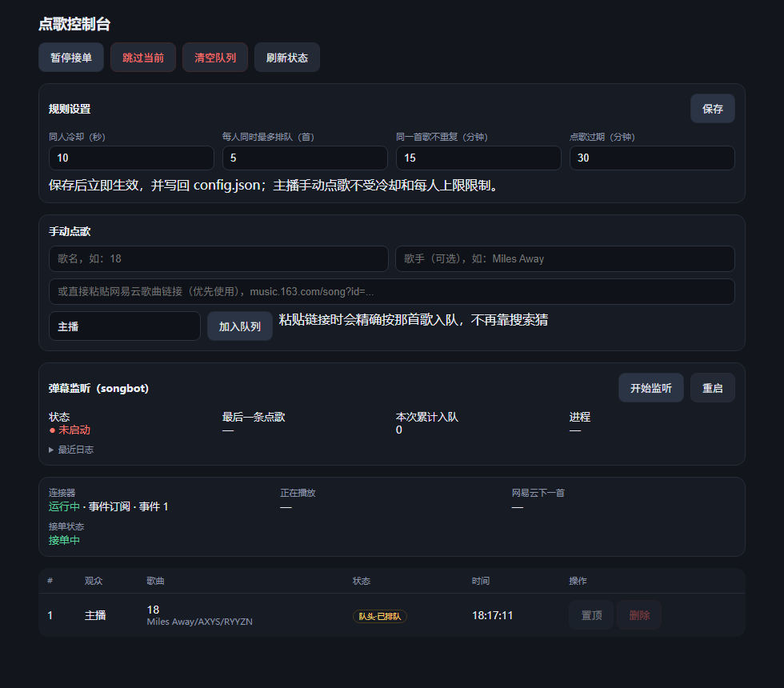

# 抖音直播间点歌机

观众在直播间发 **「点歌 歌名」**，自动排队 → 插到网易云音乐的「下一首」→ OBS 叠加层实时显示接下来 5 首要唱的歌。




---

## 它做什么

- **抓弹幕**：识别 `点歌 歌名`（也支持 `点一首` / `来一首`），自动解析歌名和歌手
- **排队**：FIFO 先来先唱；同人冷却、每人限额、同歌去重，规则随时可调
- **插播**：队头那首被插成网易云的「下一首」，当前歌唱完自动接上，点歌之间不夹你歌单里的歌
- **显示**：OBS 浏览器源显示接下来 5 首（点歌带点歌人，不足时用你歌单补位），新点歌时顶部弹 3 秒提示
- **控制面板**：手动点歌（歌名/歌手/网易云链接）、暂停接单、跳过、置顶、删除、清空、调规则
- **手机可用**：同一个 Wi-Fi 下打开控制面板，手机上就能点歌、跳过

## 环境要求

| 依赖 | 说明 |
| --- | --- |
| Windows 10 / 11 | 用了 Win32 / Job Object 等接口 |
| Python 3.10+ | 安装脚本会自己找，没有就按提示装 |
| Node.js（LTS） | 生成抖音弹幕签名用 |
| 网易云音乐 PC 客户端 3.1.x | 播放端；连接器通过它的 CEF 桥工作 |
| OBS（可选） | 只有你要把列表叠到画面上才需要 |

## 安装

1. 下载这个仓库（`git clone` 或右上角 **Code → Download ZIP** 解压）
2. 双击 **`Setup.bat`**
3. 按提示粘贴你的直播间链接（形如 `https://live.douyin.com/123456789`）

安装脚本会自动做这些事：

- 找到可用的 Python，在 `songbot\.venv` 建独立虚拟环境（不污染系统 Python）
- 安装依赖（默认用清华镜像，可用 `-Mirror` 换源）
- 拉取抖音弹幕库 [DouyinLiveWebFetcher](https://github.com/saermart/DouyinLiveWebFetcher) 到 `songbot\vendor`
- 下载并校验网易云连接器（[BiliNCM-TS](https://github.com/Enkianssus/BiliNCM-TS) 的 `Awoo.Connector.Netease`）
- 把你的直播间地址写进 `songbot\config.ini`

下载慢的话可以带代理跑：

```powershell
powershell -ExecutionPolicy Bypass -File setup.ps1 -Proxy http://127.0.0.1:7890
```

## 使用

1. 打开网易云音乐，随便放一首歌（必须是你自己的歌单，不要私人漫游/电台）
2. 双击 **`Start.bat`**（要管理员权限，连接器需要；没有会自动弹 UAC）
3. 浏览器会打开两个页面：
   - `http://127.0.0.1:8790/` —— OBS 叠加层
   - `http://127.0.0.1:8790/admin` —— 控制面板
4. OBS 里：来源 `+` → **浏览器** → URL 填 `http://127.0.0.1:8790/`，宽 `460` 高 `320`，背景透明

> 用的是「直播伴侣」也没关系：它没有浏览器源，用 OBS 的浏览器源 + 虚拟摄像头把画面送进直播伴侣即可。

## 点歌的三种方式

| 方式 | 怎么做 |
| --- | --- |
| 弹幕 | 观众发 `点歌 晴天` 或 `点歌 晴天 周杰伦` |
| 面板手动 | 控制面板 → 手动点歌 → 填歌名（+歌手）→ 加入队列 |
| 网易云链接 | 粘贴 `music.163.com/song?id=...`，按 id 精确入队，不靠搜索猜 |

主播手动点歌不受冷却和每人限额限制，但仍然去重。

## 规则

默认值（**控制面板 → 规则设置**里可改，保存即生效并写回配置）：

| 项 | 默认 |
| --- | --- |
| 同人冷却 | 10 秒 |
| 每人同时最多排队 | 5 首 |
| 同一首歌不重复 | 15 分钟 |
| 点歌过期（启动时丢弃） | 30 分钟 |

## 手机控制

`Start.bat` 启动窗口里会打印一行：

```
手机访问：http://192.168.x.x:8790/admin?token=123456
```

手机连**同一个 Wi-Fi / 热点**，打开即可（口令已带在链接里）。首次启动会自动生成口令并写进 `overlay\config.json`，同时自动添加防火墙放行规则。

> 仓库里提交的 `overlay\config.json` 口令是空的；你本机跑过之后它会变成 6 位数字，
> 属于本机配置，`git status` 里看到改动忽略即可（别提交）。

不想开局域网访问：把 `overlay\config.json` 里 `lan.enabled` 改成 `false`。

## 目录结构

```
douyin-live-songbot/
├─ Start.bat             一键启动（管理员；会顺带拉起 songbot）
├─ Setup.bat             一键安装
├─ setup.ps1             安装脚本本体
├─ songbot/              弹幕识别
│  ├─ config.ini         直播间、触发词、模式
│  ├─ songbot/           代码
│  ├─ tools/             douyin_ndjson.py、连接器安装脚本
│  ├─ vendor/            抖音弹幕库（不提交，Setup 时拉取）
│  └─ .venv/             虚拟环境（不提交，Setup 时生成）
├─ overlay/              排队 / 调度 / 面板
│  ├─ config.json        端口、规则、连接器路径、局域网口令
│  ├─ web/               OBS 叠加层 + 控制面板
│  └─ queue.json         队列状态（运行时生成）
└─ docs/                 设计决策与排坑记录
```

所有路径都是相对项目根目录的，整个文件夹可以随便挪位置。

## 常见问题

| 现象 | 原因 |
| --- | --- |
| 面板显示「连接器 未运行」 | 没用管理员启动，或网易云没开 |
| 叠加层显示「歌单同步中…」 | 当前播放的歌不在网易云播放列表里（私人漫游/电台），切回歌单播放 |
| 弹幕一直连不上 | 直播间没开播；`config.ini` 里 `room_url` 不对；或没装 Node.js |
| 某首歌搜不到 | 面板底部「最近被丢弃的点歌」会写原因；用网易云链接点歌最稳 |
| 点歌很慢/卡 | 检查终端里有没有残留 `HTTP_PROXY`（程序会自动给子进程剥掉，重启即可） |
| 手机打不开 | 不在同一网络；或电脑 IP 变了（重开热点会变），以启动窗口打印的为准 |

排错接口：

- `http://127.0.0.1:8790/api/health` —— 连接器、队列状态
- `http://127.0.0.1:8790/api/state` —— 完整队列、当前/下一首、被丢弃的点歌及原因

## 说明

- 抖音弹幕走的是**非官方 WebSocket 接口**，网易云控制走的是**连接器注入的 CEF 桥**，两者都可能随客户端更新失效，失效时升级依赖即可。
- 仅供个人直播自用。请遵守平台规则，别拿去做自动化刷量。
- 本项目以 MIT 协议开源，见 [LICENSE](LICENSE)。

## 致谢

这个项目能跑起来，主要靠下面这些：

- **DeepSeek Harness** —— 从第一版「能不能读弹幕」到最后的面板、规则、安装脚本，
  架构、代码和绝大部分排错都是在它里面对话完成的。这么说吧：
  没有它，这项目大概还停在我脑子里构思的状态。
- [DouyinLiveWebFetcher](https://github.com/saermart/DouyinLiveWebFetcher) —— 抖音直播弹幕协议，非官方但很好用。
- [BiliNCM-TS](https://github.com/Enkianssus/BiliNCM-TS) —— 网易云连接器（`Awoo.Connector.Netease`），
  在官方 IPC 被废弃之后，是它让「插到下一首」还能用。
- [嗷呜点歌机](https://github.com/Enkianssus) —— 连接器的来源与灵感。
- 网易云音乐、OBS、Node.js 以及所有被踩过的坑。

